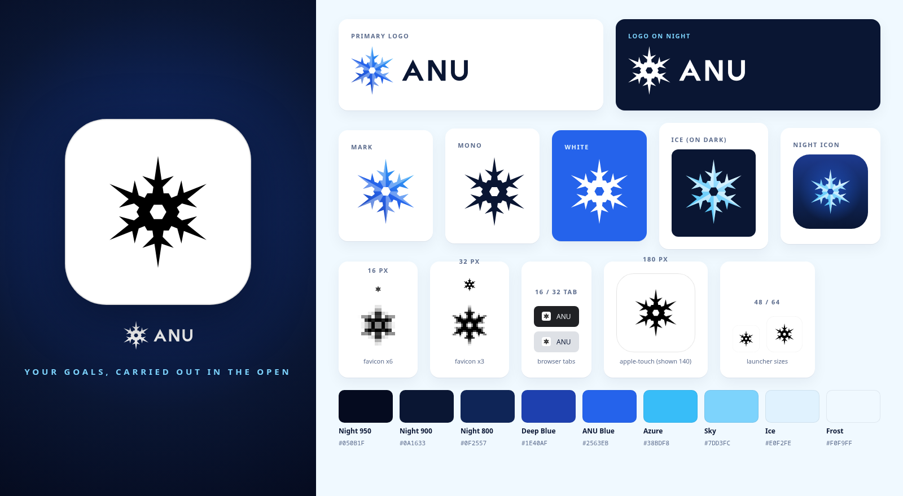
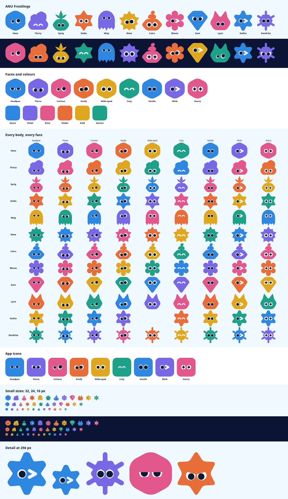

# ANU brand

Tagline: ANU is your personal AI agent. Tell it what you need and it gets it done.

The ANU mark is a blue six-pointed star that reads as a snowflake: six tapered
rays, one pair of crystal branches on each ray, and a faceted hexagon core with
an open center. Every file in this folder is hand-written SVG built from one
shared geometry, so the mark is identical everywhere it appears.

## Files

| File                 | Use                                                                  |
| -------------------- | -------------------------------------------------------------------- |
| `anu-mark.svg`       | Primary symbol, full color, for light backgrounds                    |
| `anu-mark-ice.svg`   | Symbol in the ice gradient, for night or dark backgrounds            |
| `anu-mark-mono.svg`  | Single color, `fill="currentColor"`; inherits the text color         |
| `anu-mark-white.svg` | Solid white symbol for photos, brand blue, or any dark surface       |
| `anu-logo.svg`       | Horizontal lockup: color mark plus the night-ink "ANU" wordmark      |
| `anu-logo-white.svg` | Horizontal lockup, all white                                         |
| `anu-app-icon.svg`   | App icon: ice mark on a rounded-square night gradient (1024 canvas)  |
| `favicon.svg`        | Simplified mark for 16 to 32 px: heavier rays, larger branches       |
| `preview.png`        | Reference sheet: lockups, variants, small-size renders, and palette  |

The repo's platform icons (iOS Icon Composer layers, Android launcher vectors,
macOS and Linux icon sources, Windows ICOs, Chrome extension icons, the
menu-bar glyph, and the widget mark) are all cut from these same paths. The
drift guards in `clients/ios/scripts/__tests__/` pin the iOS and Android copies
to `anu-mark.svg` and `favicon.svg`.

## Palette

| Token     | Hex       | Role                                                            |
| --------- | --------- | --------------------------------------------------------------- |
| Night 950 | `#050B1F` | Deepest background, banner and hero edges                       |
| Night 900 | `#0A1633` | Primary dark background and the wordmark ink on light surfaces  |
| Night 800 | `#0F2557` | Elevated dark surfaces; the solid app-icon ground on every OS   |
| Deep Blue | `#1E40AF` | Gradient start of the mark; pressed and strong accents          |
| ANU Blue  | `#2563EB` | Primary brand color; buttons, links, focus                      |
| Azure     | `#38BDF8` | Bright accent; gradient end of the mark; highlights on dark     |
| Sky       | `#7DD3FC` | Secondary text and accents on dark; ice mark base tone          |
| Ice       | `#E0F2FE` | Facet highlights; tinted light surfaces                         |
| Frost     | `#F0F9FF` | Lightest page background                                        |

Gradients:

- Mark on light: Deep Blue `#1E40AF` to ANU Blue `#2563EB` to Azure `#38BDF8`,
  running from bottom left to top right, with Ice `#E0F2FE` facets at 40%
  opacity.
- Mark on dark (ice): Azure `#38BDF8` to Sky `#7DD3FC` to Ice `#E0F2FE`, with
  white facets at 55% opacity.
- App icon ground: `#1D3A8F` at the top, Night 800 `#0F2557`, then Night 900
  `#0A1633` at the bottom, with an ANU Blue radial glow behind the mark.
- Flat two-tone (platforms without gradients): Sky `#7DD3FC` base with Ice
  `#E0F2FE` facets on night grounds; Night 900 `#0A1633` base with Deep Blue
  `#1E40AF` facets on light grounds.

Environment colors for non-production builds: staging keeps yellow `#E9C91A`
and dev keeps pink `#FF88C9` as icon grounds; local uses `#3981F2`. Chrome
extension badges use Amber `#F59E0B` (staging), Pink `#EC4899` (dev), and
Emerald `#10B981` (local).

## Usage

- Prefer `anu-logo.svg` on light surfaces and `anu-logo-white.svg` on Night
  900 or darker. Use the mark alone where space is square or tight.
- On dark UI, use `anu-mark-ice.svg` or `anu-mark-white.svg`. The light-scheme
  `anu-mark.svg` loses its deep-blue rays on night backgrounds.
- Use `anu-mark-mono.svg` inside UI chrome where the mark should follow the
  text color (it uses `currentColor`).
- Below 32 px, use `favicon.svg`; the full mark's branches fill in at that size.
- Do not recolor the mark outside the palette, add strokes or shadows, rotate
  it, stretch it, or rearrange the lockup. The wordmark is custom geometry, not
  a font; do not retype it.

## Clear space and minimum size

- Clear space around the mark equals one quarter of its height (25 units on the
  100-unit canvas, roughly the length of one crystal branch). Keep text, edges,
  and other graphics outside that zone.
- Clear space around the logo equals the wordmark's cap height on every side.
- Minimum sizes: mark 16 px (use `favicon.svg`), logo 72 px wide on screen and
  18 mm in print.

## Geometry

- 100 by 100 canvas, centered at (50, 50). Rays point straight up and down, so
  the mark is 94 units tall and 81.4 units wide.
- Each ray is a straight taper from a 11.6-unit base to a sharp tip at radius
  47. One branch pair leaves each ray at radius 22, angled 58 degrees outward,
  15.5 units long.
- The core is a hexagon of radius 18 with flat edges facing the rays, opened by
  a concentric hexagon of radius 7.
- Lighting splits the star into 12 facets: the counterclockwise half of each
  ray's wedge is lit, which gives the crystal its bevel and its quiet rotation.
- All outlines are straight segments (`M`, `L`, `Z` only) and a single unioned
  path with the core hole wound in reverse, so the silhouette renders the same
  under nonzero and even-odd fill and in the minimal SVG parsers the desktop
  icon pipeline uses.
- The wordmark is drawn at cap height 40 with a 7.4-unit stroke: an `A` whose
  sharp apex echoes the star's rays, a single-diagonal `N`, and a round `U`,
  tracked wide for calm. In the lockup the wordmark is vertically centered on
  the mark, 17 units to its right.

## Design rationale

ANU carries out goals in the open, so the mark is a star: a fixed point you
steer by, with six even rays that read as outward motion in every direction.
Drawn as a snowflake it also says that no two runs are the same, yet every one
follows the same six-fold order. The faceted core is the assistant itself: a
solid, structured center with an open window through it, nothing hidden. The
icy blues keep the brand cool and trustworthy, with deep night grounds that let
the ice tones glow, and the crisp straight-edged geometry holds up from a 16 px
browser tab to a 1024 px app icon.

## Characters

An assistant's avatar is a frostling: a flat-colour frost spirit built from
hexagons, shards and facets. There are twelve bodies (Hexa, Flurry, Sprig,
Stella, Wisp, Rime, Cairn, Bloom, Gem, Lynx, and two snow crystals, Stellar
and Dendrite, drawn from the mark itself), nine expressions of ice-white eyes
with Night pupils, and six colours: Azure `#2F86E0`, Violet `#7B68E6`, Rose
`#E2588A`, Ember `#E96D38`, Gold `#E0A91F` and Aurora `#1FA088`.

Avatars move with the assistant (`avatars-motion.gif`): a slow breath at rest,
a blink every few seconds, a wobble while it works, a hop when something
succeeds, and a side-to-side glance while it waits on you. All of it is
transform-only CSS and stops under reduced motion.

The geometry and palette live in `packages/avatar-catalog`; the iOS and
Android app icons and the web mascot strips are generated from it.
